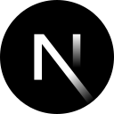
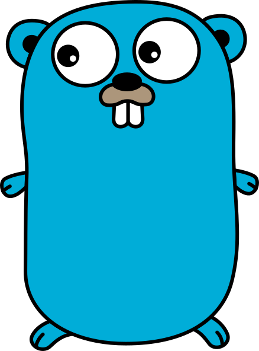

# Olá, eu sou o [Davi Peterson](https://davi-peterson.vercel.app/pt)

Desenvolvedor de software e fundador da [SyncForge](https://syncforge-business.vercel.app/). Construo aplicações web e produtos digitais de ponta a ponta, com **Next.js** e **Angular** no frontend e **NestJS** e **Go** no backend, em projetos próprios e em soluções para empresas.

Estou no 4º período de Análise e Desenvolvimento de Sistemas na UniNorte.

  

## Tecnologias

  
  &nbsp;&nbsp;&nbsp;
  
  &nbsp;&nbsp;&nbsp;
  
  &nbsp;&nbsp;&nbsp;
  

## Sobre mim

Trabalho em todas as camadas de uma aplicação: da interface e da experiência do usuário até APIs, banco de dados, cache, filas, integrações e processamento assíncrono.

Já atuei como líder técnico no frontend e no backend. Nesse papel, faço code review, participo das decisões de arquitetura, defino padrões de código, organizo as demandas e dou suporte aos desenvolvedores durante a entrega.

Hoje estou me aprofundando em arquitetura de software, estudando DDD, monólitos modulares, microsserviços e arquitetura orientada a eventos.

## Contato

* E-mail: **[davipetersondev173@gmail.com](mailto:davipetersondev173@gmail.com)**
* LinkedIn: [linkedin.com/in/davipeterson](https://www.linkedin.com/in/davipeterson/)
* Portfólio: [davi-peterson.vercel.app](https://davi-peterson.vercel.app)
* SyncForge: [syncforge-business.vercel.app](https://syncforge-business.vercel.app/)

---

  

